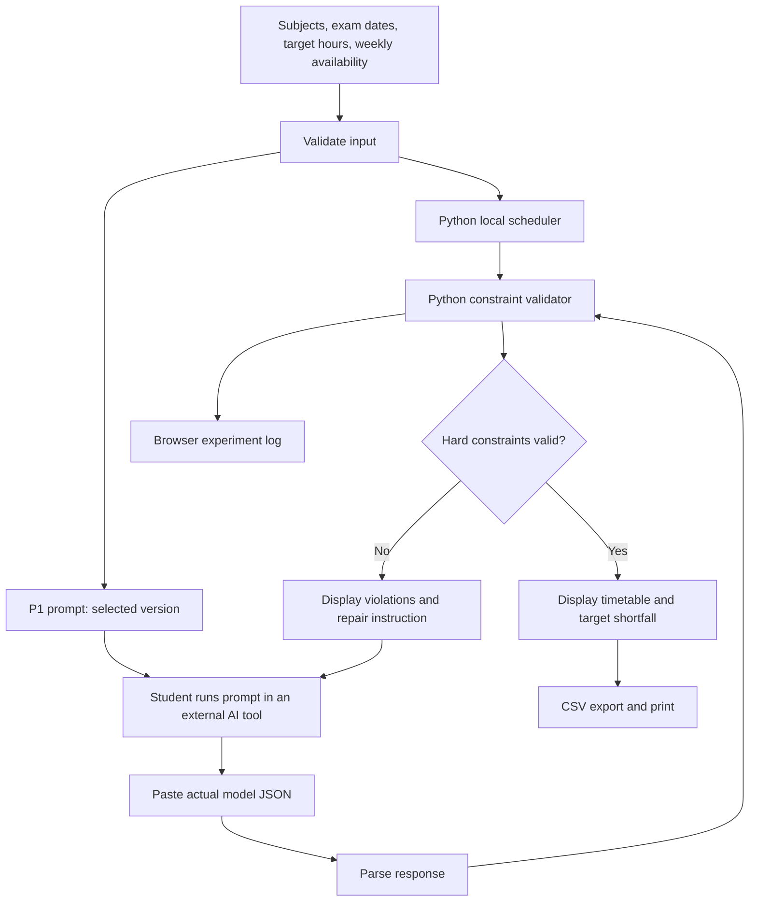

# Studyflow architecture

Task decomposition: input capture → input validation → schedule generation → constraint checks → completeness checks → display/export. The local scheduler and manual model workflow share the same validator.

Input–output flow: structured student data → local scheduler OR P1 user prompt → `{days: [{date, sessions: [{subjectId, hours, task}]}]}` → checks and per-subject coverage → day-wise table.

System: HTML/CSS/JavaScript browser interface → same-origin HTTP API → Python scheduling engine, validator and CSV export. Python serves frontend files directly. Plans/history use localStorage; the server does not persist student inputs. The external AI tool is user-operated. No accounts or model API credentials are required. External AI calls are manual. Browser fonts may be fetched from Google Fonts; app functionality uses system fonts if unavailable.

Hosting: Vercel invokes api/index.py in the NEBULA LABS project. That entry point reuses the local Python handler. GitHub pushes to main deploy the same code, and vercel.json routes the homepage, static files, and API requests into the function.

No autonomous agents or retrieval are implemented. Repair is a human-operated feedback loop. There are two final prompt templates: P1 generation and P2 conditional repair. P1 has three authored versions; these are not three separate final prompts. P2 takes the variable {issues} containing observed violations/shortfalls and is used in the same external model conversation as P1. Include a real repair run in the assessed evidence if claiming this module.
